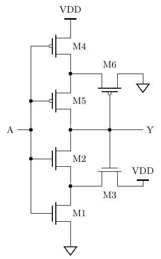
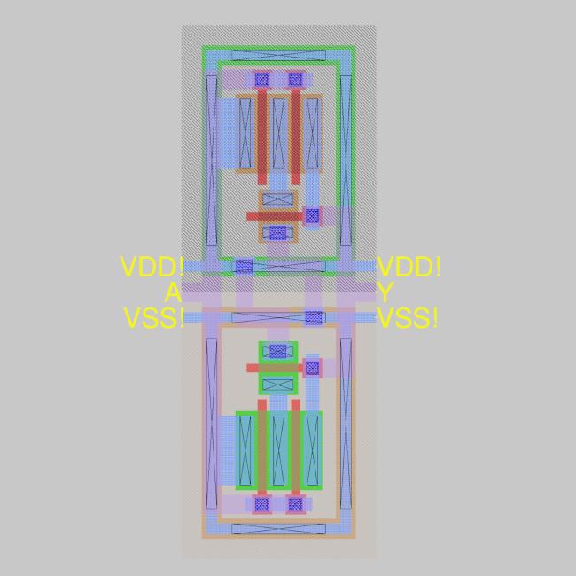

## How it works

Several inverting Schmitt triggers with different thresholds are connected to an internal DAC. The voltage produced by the DAC is controlled by the digital inputs `ui_in[7:0]`. Each Schmitt trigger presents its state on the corresponding `uo_out[3:0]` pin.

Three additional free-standing inverting Schmitt triggers are available on the bidirectional pins. With these and a few external RC components, simple oscillators can be built.

## How it came to be

Thanks to SwissChips sponsorship, I was able to participate in the previous IHP26a run with an 8-bit floating-point multiplier. There I used everything the OSS tools offer to squeeze a near-perfect design out of very imperfect and _lazy_ HDL code. Great.

But for this second run, IHP26b, I wanted to go a level deeper: to the physical world. No nice zeros and ones, only the raw [_analoginess_](https://youtu.be/Eu_crbcBdNM?si=nth6YxzOZvTxItNz&t=135) of CMOS technology.

The initial idea was to _again_ build a multiplier, but one that multiplies in the physical world, i.e. produces some voltages that by nature get multiplied together and are then converted back to digital. Easy! Well, not so much. The amount of work needed to make that last bit, the ADC, work is simply too much. Sure, [others](https://github.com/psychogenic/tt06-analog-wowa) [have](https://github.com/wulffern/tt06-sar) [built](https://github.com/htfab/flash-adc) one. But I'm chronically late and the design is due in a month.

So what else can we do? Analog tiles are not available for this run, but nothing prevents us from putting analog circuitry behind a digital facade. So we have a digitally controlled voltage source, i.e. a DAC, feeding multiple Schmitt triggers, each with a different threshold. That way we can sort of _gauge_ the voltage produced internally.

The project name _Mixer_ simply stands for _mixed-signal_ and has nothing to do with the classic dual-gate MOSFET RF mixer circuit.

## The inner workings

All Schmitt trigger variants are built from the same basic circuit. At its core, it is just an inverter with the classic NMOS and PMOS transistors. However, the pull-up and pull-down transistors are each split in half, and the voltage of the resulting middle node is controlled by a third transistor. Depending on the current output state, these _middle nodes_ are pulled towards VDD or GND, which shifts the input voltage at which the _inverter_ trips.

The circuit was designed and simulated in Xschem and laid out in Magic VLSI. The thresholds of the Schmitt trigger depend on the gate widths and lengths of M1, M2, M4, and M5. The layout is drawn so that the other variants can be derived from this basic layout simply by stretching the fingers of the two-finger MOSFETs, i.e. increasing their gate width.

(Also: I know, I know, the PMOS side should be ~2x bigger, but here we are.)

In the end, I included four variants:
- _1v1_: all gate widths are equal
- _2v1_: gate width of M1, M2, M4, and M5 is 2x that of M3 and M6
- _4v1_: gate width of M1, M2, M4, and M5 is 4x that of M3 and M6
- _8v1_: gate width of M1, M2, M4, and M5 is 8x that of M3 and M6

## How to test

### Voltage-controlled Schmitt triggers

Set the internal DAC voltage via the bits `DAC[7:0]` (`ui_in[7:0]`). A value of `0b00000000` corresponds to _0 V_, whereas `0b11111111` corresponds to _1.2 V_. The current state (on or off) of each Schmitt trigger is visible in the `trigger*` bits of `uo_out[3:0]`.

Play around and try to find the on and off threshold voltages of the four Schmitt trigger variants. One approach is to start at _0 V_, sweep slowly up to _1.2 V_, and then back down to _0 V_, noting the changes of the `trigger*` bits at each step. At first, all bits should be on (because the Schmitt triggers are inverting). Then the variants 8v1, 4v1, 2v1, and finally 1v1 should turn off, in that order. On the way down, they should turn back on in the same order: 8v1 first, 1v1 last.

**Note:** Because the DAC is built from a resistor ladder, the internally produced voltage is very sensitive to the relative timing of the individual `DAC[7:0]` bits, especially the MSBs. Take great care to change all bits to the new value at the same time. If, for example, the MSB changes first and the LSBs only later, the internal voltage immediately jumps to an unintended value and only afterwards settles at the desired one. This can cause all Schmitt triggers to, well, trigger, even though their threshold voltage was never actually reached.

Expected thresholds according to the simulation models:

|     | Voff | Von  |
|-----|------|------|
| 1v1 | 0.77 | 0.43 |
| 2v1 | 0.72 | 0.47 |
| 4v1 | 0.67 | 0.51 |
| 8v1 | 0.62 | 0.53 |

### Free-standing Schmitt triggers

Three additional free-standing Schmitt triggers are available on the bidirectional pins. Use the `ST*_IN` pins as inputs and the `ST*_OUT` pins as outputs. I don't expect the internal pin mux of the TT harness to pass analog voltages to these pins, but if it does, these Schmitt triggers can be characterized very easily through it. Alternatively, a simple oscillator can be built with a few external components: connect _OUT_ to _IN_ through a resistor of a few kΩ and tie _IN_ to GND through a capacitor of a few µF.